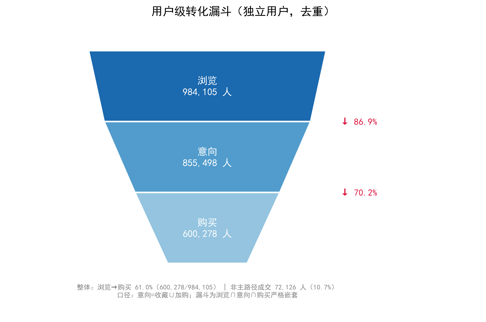
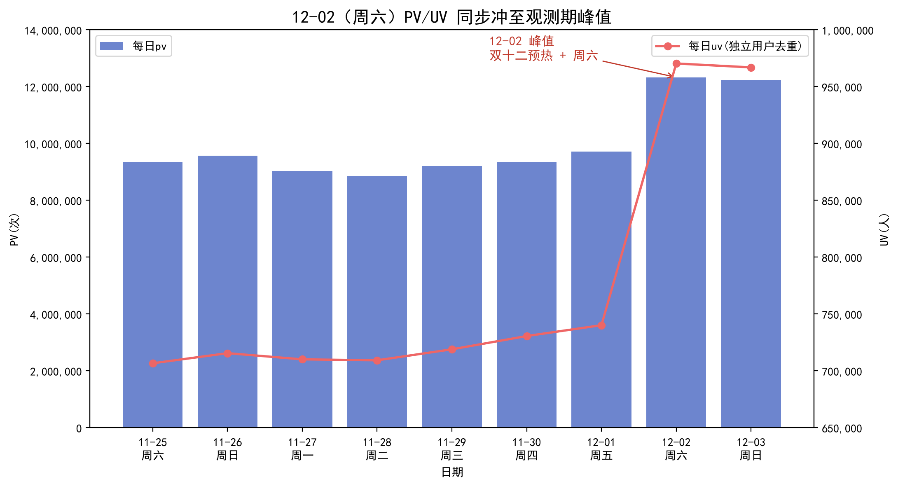
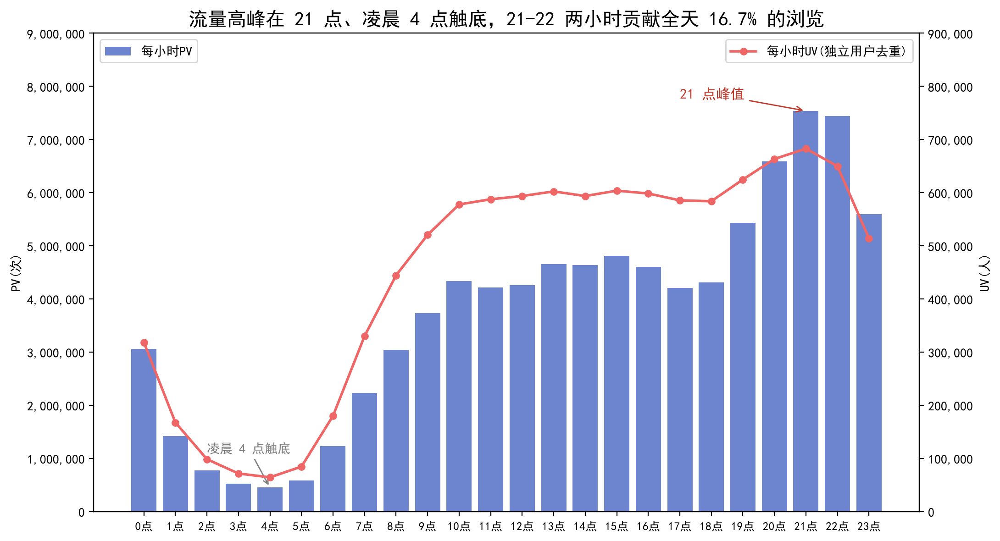
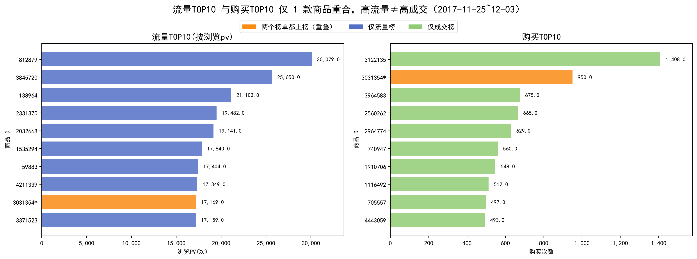
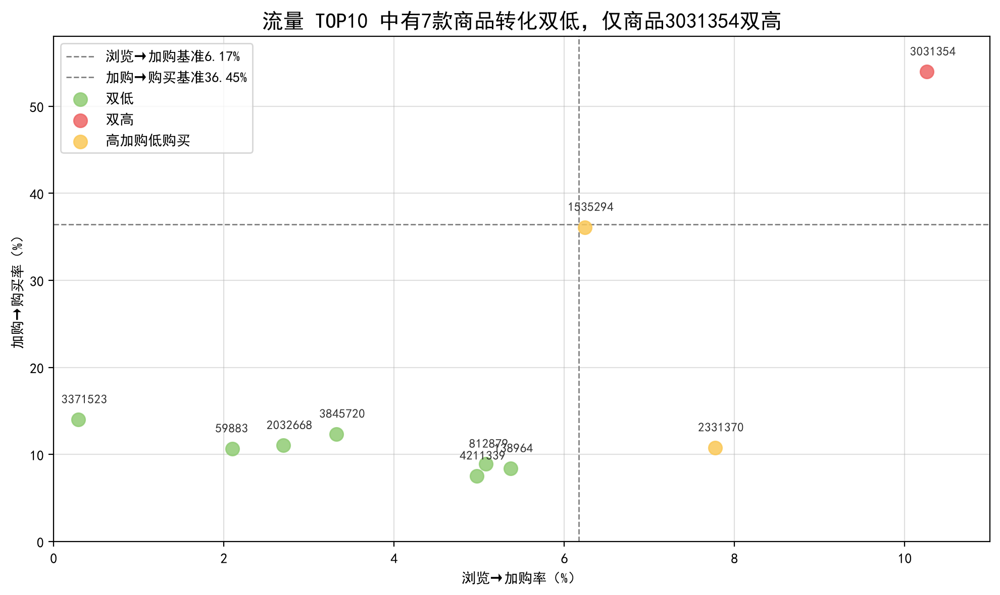
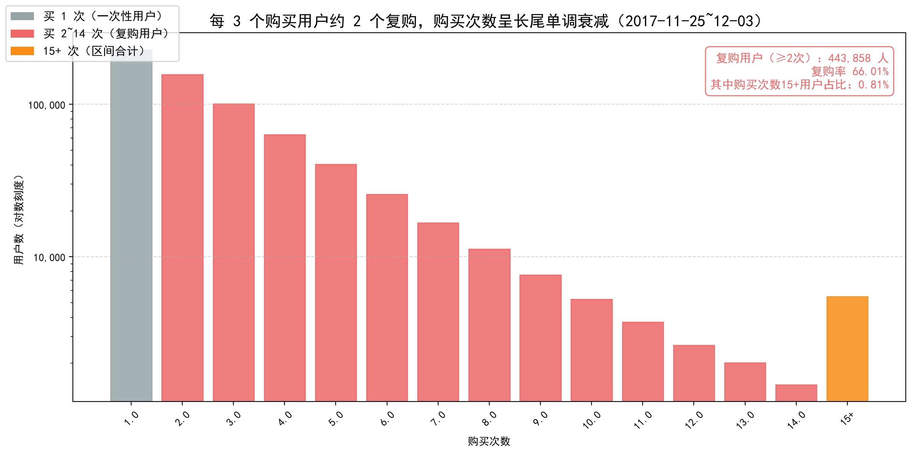

# 淘宝用户行为分析报告

## 一、项目背景

本报告基于[阿里云天池数据集：《淘宝用户购物行为数据集》](https://tianchi.aliyun.com/dataset/649) UserBehavior.csv进行展开，先用Mysql对一亿条数据进行清洗，再用Python(numpy/pandas/matplotlib)对数据进行可视化分析，给出：用户行为转化漏斗、分时规律、商品结构和用户复购四个维度的结论和运营建议。
## 二、数据说明与口径

### 1.数据说明
**数据结构：**

| 字段名 | 说明 |
|---|---|
| user_id | 用户ID（序列化） |
| item_id | 商品ID |
| category_id | 商品类目ID |
| type | 用户行为类型 |
| time_stamp | 时间戳（秒） |

**行为类型：**
- `pv` ：浏览
- `cart` ：加购
- `fav` ：收藏
- `buy` ：购买

### 2.数据口径
**数据处理：**
- 对原始数据进行去重、剔除异常行为和超出观测窗口的记录，得到 100,095,182 条有效行为。
**时间范围：**
- 数据清洗后得到的时间范围：2017年11月25日 - 2017年12月3日
**核心指标：**

| 指标 | 字段 | 数值 |
|---|---|---|
| 总记录数 | total_rows | 100,095,182 |
| 独立用户数 | total_uv | 987,991 |
| 浏览行为量 | total_pv | 89,660,671 |
| 收藏行为量 | total_fav | 2,888,258 |
| 加购行为量 | total_cart | 5,530,446 |
| 购买行为量 | total_buy | 2,015,807 |
| 购买用户数 | buy_users | 672,404 |

## 三、核心发现

### 1. 转化漏斗分析
#### 1.1 转化主卡点在"意向→购买"，流失 29.8%
口径说明：收藏和加购是同级行为，并不是先后行为，故本漏斗的结构为： 浏览→意向（收藏∪加购）→购买

- 结论:984,105 名浏览的用户中仅流失128,607名（13.1%）用户，但是855,498 名 "浏览且形成意向" 的用户中流失255,220 人（29.8%），故 “意向（收藏∪加购）→ 购买” 是流失最严重的环节。

#### 1.2 意向信号越强，购买率越高
为进一步探究用户流失的环节，我们利用Mysql语句查询，得到如下表格：
| 用户意向 | 购买者 | 未购买者 | 合计 | 购买占比 |
|---|---:|---:|---:|---:|
| 加购且收藏 | 203,606 | 64,117 | 267,723 | 76.05% |
| 仅加购 | 324,802 | 143,149 | 467,951 | 69.41% |
| 仅收藏 | 71,870 | 47,954 | 119,824 | 59.98% |
| **合计** | **600,278** | **255,220** | **855,498** | **70.17%** |

- 结论：意向信号越强，购买占比越高

#### 1.3建议
- 加购未购买的207,266 名用户是精准运营的核心对象，可定向发放优惠券；仅收藏未购买用户（47954 名）运营应该及时推送商品核心卖点与降价 / 库存提醒。

### 2.用户访问量分析（PV/UV）
#### 2.1 流量高峰在晚间，12-02 冲至观测期峰值

- 结论：21-22 点, 贡献全天浏览量的 16.7%；日访问量PV / UV在12-02（周六）这天冲至峰值，较前7日均值分别上涨32.6%/35.0%。

#### 2.2建议
运营按照日维度和小时维度分别安排:
- 日维度:主要营销力度应该集中在12-02~12-03两天，活动排期、上新与资源位应向周末倾斜；
- 小时维度：20~22点是触达黄金窗口，适合集中投放内容种草、推送活动通知与领券指导,19-23 点宜安排客服与直播主力时段,0-6 时活跃极低，不安排运营动作，避免打扰与资源浪费。

### 3. 热门商品的浏览量与购买量分析
#### 3.1高流量 ≠ 高成交：双榜仅 1 款商品重合
 
- 结论：两个榜单仅有一个商品（商品ID：3031354）重叠，流量榜冠军未进购买榜，购买榜冠军未进流量榜。按转化两率分型后可见，仅商品ID:3031354 唯一转化双高；流量TOP10的7款商品（含流量榜冠军商品ID: 812879）的两率均低于全量基准。
#### 3.2 建议
- 双高商品做标杆，双低商品缩无效流量投放，高加购低购买商品应该优化商品详情页及时发放优惠券和活动提醒。
### 4. 复购与频次分析
#### 4.1 每 3 个购买用户约 2 个复购，次数呈长尾衰减

- 结论：购买一次的用户占比33.99%，复购用户占比 66.01%，购买次数呈长尾单调衰减，平均衰减比 0.68（本级人数÷上一级人数）；复购用户人均购买 4.03 次，购买15 次及以上用户占 0.81%。
#### 4.2 建议
- 分人群看：对购买一次的用户应做首购后触达；对购买2~4次的用户及时发送复购优惠券、引导加入会员并突出会员权益，推动频次上台阶；对于购买次数15次及以上的群体做一对一运营。
## 四. 局限性
- 数据仅含四类行为、**无退款字段**：复购率按购买行为计，无法剔除退货；大促凑单
  "下单即退"会使其高于真实成交口径（场景推测，数据无法直接验证）
- **9 天窗口右删失**：观测期末首次购买的用户（66,457 人）无完整复购时间，使复购率
  被低估——与上述高估方向相反，净偏差方向不确定
- 复购率为 9 天同窗口口径，**不可外推**为月度 / 年度复购率
- 意向分档转化率为观察性证据，未做因果识别

